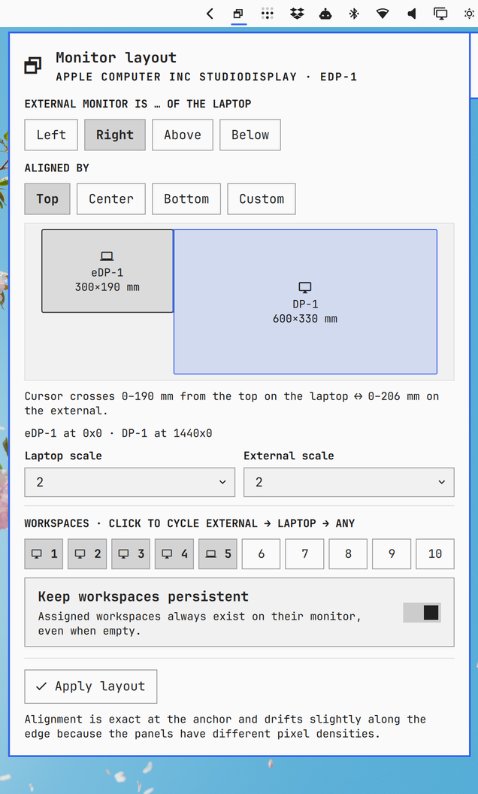

# omarchy-monitor-layout

Place an external monitor next to your laptop **in physical terms** and bind
workspaces to monitors **permanently**, from a panel in the Omarchy bar.



Tell the plugin which side of the laptop the external display sits on and how
the two are aligned on the desk (top edges, centres, bottom edges, or a custom
millimetre offset). It converts that into Hyprland monitor positions so the
cursor leaves one screen and arrives on the other where you expect. Then click
workspaces 1 to 10 to say which monitor each one lives on.

Layouts are saved per external monitor (keyed by its EDID description), so the
Studio Display at home and the projector at work each keep their own settings,
and Hyprland re-applies them on its own the moment the monitor is plugged in.

## Features

- **Side and alignment** — left / right / above / below, aligned by leading
  edge, centre, trailing edge, or a custom offset in millimetres
- **To-scale preview** — both panels drawn from their physical size, with the
  shared edge where the cursor can cross highlighted and quoted in millimetres
- **Per-monitor scale** — the generated rules carry the scale you choose
- **Workspace binding** — cycle each workspace between external, laptop, and
  any; optionally persistent so bound workspaces always exist on their monitor
- **One profile per external monitor**, applied automatically on hotplug
- **Bar shortcuts** — left-click opens the panel, right-click re-applies
- **IPC** for keybindings and scripts (see below)

## Requirements

- [Omarchy](https://omarchy.org) 4.x with Hyprland configured in Lua
- `bash`, `jq`, `hyprctl` (all present on a stock Omarchy install)

No sudo, no network access, no extra packages.

## Install

```bash
omarchy plugin add https://github.com/esemczak/omarchy-monitor-layout.git --enable --yes
omarchy restart shell
```

Then open the panel and press **Install into hyprland.lua**. That adds one
line to `~/.config/hypr/hyprland.lua` right after the monitors require, after
saving a timestamped backup:

```lua
require("hypr.monitor-layout")
```

You can add the line yourself instead. It must come after
`require("hypr.monitors")` so the plugin's specific monitor rules override
Omarchy's catch-all rule.

### Manual copy

```bash
git clone https://github.com/esemczak/omarchy-monitor-layout.git \
  ~/.config/omarchy/plugins/esemczak.monitor-layout
omarchy plugin validate ~/.config/omarchy/plugins/esemczak.monitor-layout
omarchy plugin enable esemczak.monitor-layout right
omarchy restart shell
```

## Usage

1. Connect the external monitor and click the bar icon.
2. Pick the side it is on and how it lines up with the laptop.
3. Click workspace numbers to assign them. A monitor glyph means external, a
   laptop glyph means laptop, no glyph means unassigned.
4. Press **Apply layout**. Hyprland reloads and the footer reports the result.

Keyboard: `j`/`k` move between rows, `h`/`l` within a row, `Enter` activates,
`a` applies, `r` refreshes monitors, `Esc` closes.

## How it works

The plugin writes `~/.config/hypr/monitor-layout.lua`, for example:

```lua
hl.monitor({ output = "eDP-1", mode = "preferred", position = "0x0", scale = 2 })
hl.monitor({ output = "desc:Apple Computer Inc StudioDisplay 0xB65A586D", mode = "preferred", position = "1440x0", scale = 2 })

hl.workspace_rule({ workspace = "1", monitor = "desc:Apple Computer Inc StudioDisplay 0xB65A586D", persistent = true })
hl.workspace_rule({ workspace = "5", monitor = "eDP-1", persistent = true })
```

The external monitor is matched by description, so the rules survive a change
of port. Because they live in Hyprland config, Hyprland applies them itself
when the monitor appears, with no daemon in between. When a *different* saved
monitor is connected the plugin regenerates the file for that profile.

Settings live in `~/.local/state/omarchy/settings/monitor-layout.json`.

### Physical alignment

Millimetre offsets are converted to logical pixels using the laptop panel's
pixel density. The two displays almost always have different densities, so the
alignment is exact at the anchor you chose and drifts slightly along the rest
of the edge. The preview quotes the crossing range on both monitors so you can
see the difference. This is inherent to how Hyprland routes the cursor across
rectangular logical outputs, not something the plugin can fully remove.

### Scale

The generated rules set an explicit scale for both monitors. Changing scale in
Omarchy's built-in Display panel edits `monitors.lua`, which this file
overrides, so change scale here instead while the plugin is installed.

## IPC

```bash
omarchy-shell esemczak.monitor-layout open|close|toggle
omarchy-shell esemczak.monitor-layout apply
omarchy-shell esemczak.monitor-layout install
omarchy-shell esemczak.monitor-layout setSide left|right|above|below
omarchy-shell esemczak.monitor-layout setAlign start|center|end|custom
omarchy-shell esemczak.monitor-layout setOffset 40
omarchy-shell esemczak.monitor-layout setWorkspace 3 external|internal|none
omarchy-shell esemczak.monitor-layout lua      # print the Lua that would be applied
omarchy-shell esemczak.monitor-layout status   # JSON
```

## Remove

```bash
omarchy plugin disable esemczak.monitor-layout
omarchy plugin remove esemczak.monitor-layout --yes
omarchy restart shell
```

Then delete the require line from `~/.config/hypr/hyprland.lua` and remove
`~/.config/hypr/monitor-layout.lua`. Optionally delete the saved settings:

```bash
rm -f ~/.local/state/omarchy/settings/monitor-layout.json
```

## Development

```bash
node --test tests/               # pure layout, state and Lua rendering tests
bash tests/apply-layout.test.sh  # shell helpers against a temp HOME and fake hyprctl
./dev-install.sh                 # copy into ~/.config/omarchy/plugins/ and validate
```

The shell hot-reloads plugin files, but a hot reload keeps the original
instance serving IPC. After changing `Panel.qml` or `Service.qml`, run
`omarchy restart shell` to test IPC changes.

## License

MIT
